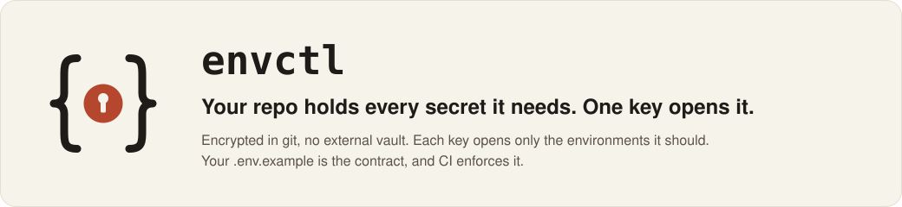
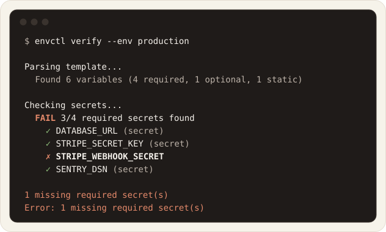
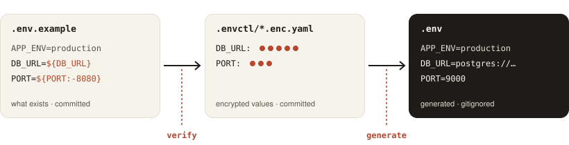
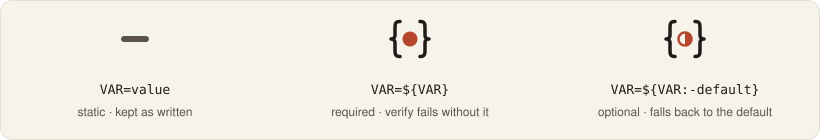
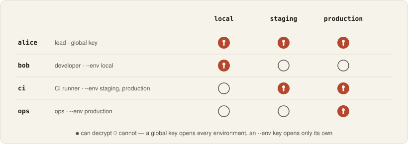

<p align="center">
  <picture>
    <source media="(prefers-color-scheme: dark)" srcset="docs/brand/hero-dark.svg">
    
  </picture>
</p>

<p align="center">
  
  
  
  
</p>

**envctl keeps your project's secrets in the project.** Which variables exist, their values for every environment, and who can read them all live in the repository, encrypted with [SOPS](https://getsops.io) and [age](https://github.com/FiloSottile/age). There is no vault to host, no account to create, no service to keep in sync. Clone the repo, get your key, run `envctl generate`: you can work.

- **Self-contained.** The template, the encrypted values and the list of keys are committed. No server, no account, no lock-in: the secrets stay plain sops files.
- **Access per environment.** Developers open `local`. Only ops and CI open `production`. One command adds or revokes a key and re-encrypts.
- **Never ship an empty var.** `envctl verify` fails the build when a variable of `.env.example` has no value for the target environment.

## Never ship an empty env var again

<p align="center">
  <picture>
    <source media="(prefers-color-scheme: dark)" srcset="docs/brand/verify-dark.svg">
    
  </picture>
</p>

Someone added `STRIPE_WEBHOOK_SECRET` to `.env.example` and forgot production. `envctl verify` exits with code 1, and the deploy stops here instead of failing later in production.

## How it works

<p align="center">
  <picture>
    <source media="(prefers-color-scheme: dark)" srcset="docs/brand/flow-dark.svg">
    
  </picture>
</p>

Your `.env.example` is the contract. Each line is one of three kinds:

<p align="center">
  <picture>
    <source media="(prefers-color-scheme: dark)" srcset="docs/brand/classes-dark.svg">
    
  </picture>
</p>

| Line in `.env.example` | Kind | What envctl does |
|---|---|---|
| `PORT=3000` | static | Copies it as written |
| `DATABASE_URL=${DATABASE_URL}` | required | Takes the value from the encrypted file; `verify` fails without one |
| `LOG_LEVEL=${LOG_LEVEL:-info}` | optional | Takes the encrypted value, or falls back to `info` |

The template does not have to be a `.env` file: any text file with `${VAR}` placeholders works, such as a YAML or JSON config.

## Install

With [Homebrew](https://brew.sh) (installs `sops` and `age` too):

```sh
brew install pillowpillow/tap/envctl
```

Or with the install script, then install [`sops`](https://github.com/getsops/sops#download) and [`age`](https://github.com/FiloSottile/age#installation) yourself:

```sh
curl -fsSL https://raw.githubusercontent.com/PillowPillow/envctl/main/install.sh | bash
```

The script installs the latest release in `~/.envctl/bin` and checks its sha256 checksum; if the [GitHub CLI](https://cli.github.com) is signed in, it also verifies that the archive was built by this repository's release workflow. [Read `install.sh`](install.sh) before you run it. To pin a version, pass it to `bash`, not to `curl`: `curl -fsSL https://raw.githubusercontent.com/PillowPillow/envctl/main/install.sh | ENVCTL_VERSION=v2.1.0 bash`. `INSTALL_DIR` works the same way.

envctl runs on macOS and Linux, on amd64 and arm64.

<details>
<summary>Install with Go</summary>

```sh
go install github.com/PillowPillow/envctl/v2@latest
```

You need `sops` and `age` on your `PATH` as well.
</details>

<details>
<summary>Run with Docker</summary>

The image bundles envctl, sops and age:

```sh
docker run --rm -v "$PWD:/workspace" -e SOPS_AGE_KEY ghcr.io/pillowpillow/envctl:2.1.0 verify --env production
```
</details>

<details>
<summary>Verify a release</summary>

Every release archive carries a build provenance attestation. With the GitHub CLI signed in:

```sh
gh attestation verify envctl_<os>_<arch>.tar.gz --repo PillowPillow/envctl --signer-workflow PillowPillow/envctl/.github/workflows/release.yaml
```
</details>

## Quickstart

In a project that already has a `.env.example`:

```sh
envctl init                                                                # writes .envctl.yaml, creates .envctl/, updates .gitignore
mkdir -p ~/.config/sops/age && age-keygen -o ~/.config/sops/age/keys.txt  # your key pair, if you do not have one yet
export SOPS_AGE_KEY_FILE=~/.config/sops/age/keys.txt                      # where sops finds it (put this in your shell profile)
envctl keys add me <your age1… public key>                                 # lets your key open every environment
envctl edit --env local                                                    # fill in the values, saved encrypted
envctl verify --env local                                                  # checks every required variable has a value
envctl generate --env local --output .env                                  # writes the plaintext .env you run with
```

Commit `.envctl.yaml` and `.envctl/`. A teammate who clones the repo only needs their key added to run `envctl generate`.

## Who can open what

<p align="center">
  <picture>
    <source media="(prefers-color-scheme: dark)" srcset="docs/brand/access-dark.svg">
    
  </picture>
</p>

```sh
envctl keys add bob age1… --env local         # bob reads local only
envctl keys add ops age1… --env production    # ops reads production only
envctl keys remove bob --env local            # revoke and re-encrypt
```

A key added without `--env` is global: it opens every environment. Environments that point to one secrets file must have the same keys, unless each is marked `shared: true`, in which case a key added to one opens them all. Details in [Keys and re-encryption](docs/keys.md).

## Use it in CI

The composite action runs envctl from its Docker image; CI needs only one age private key, stored as the `SOPS_AGE_KEY` secret.

```yaml
- uses: PillowPillow/envctl@v2.1.0
  with:
    command: verify
    environment: production
    envctl-version: 2.1.0
  env:
    SOPS_AGE_KEY: ${{ secrets.SOPS_AGE_KEY }}
```

Use `command: generate` to write the `.env` in the job workspace before your build. Pin `envctl-version` as well as the action: it selects the image, and defaults to `latest`. A reusable workflow for a standalone verify check and the full list of inputs are in [CI](docs/ci.md).

## How it compares

| Compared with | Where envctl helps | Where the other tool is better |
|---|---|---|
| [sops](https://getsops.io) alone | A `verify` gate against `.env.example`, a diff between environments, overrides, and keys added or removed by name and environment, with re-encryption, instead of editing `.sops.yaml` rules | More key backends (AWS, GCP, Azure and HuaweiCloud KMS, HashiCorp Vault, PGP); `sops exec-env` runs a process without writing a file. envctl files stay plain sops files, so you can drop envctl at any time |
| [dotenvx](https://dotenvx.com) | Each person and each CI runner has their own age key, which can be limited to some environments; removing a key re-encrypts the files | One binary with nothing else to install, Windows support, and `dotenvx run` injects values at runtime instead of writing a `.env` |
| [varlock](https://varlock.dev) | A shared encrypted store committed to git, driven by the `.env.example` syntax you already have | Typed validation, log redaction and leak scanning, Windows support; team secrets come from plugins such as 1Password or Infisical |
| [Doppler](https://www.doppler.com), [Infisical](https://infisical.com) | No server or account, works offline, and secret changes are reviewed in pull requests | Audit logs, access control, automatic rotation and dynamic secrets (on their paid plans); Infisical can be self-hosted |
| [1Password CLI](https://www.1password.dev/cli/) (`op run`) | No 1Password account needed; CI needs a single age key | Values reach a subprocess only for its lifetime instead of a `.env` file; fits teams already on 1Password |

### When not to use envctl

- You need an audit log of who read which secret.
- You need to revoke access without changing the values: git history keeps old encrypted versions readable by every key that could open them.
- You need dynamic or automatically rotated secrets.
- You develop on Windows.
- Your secrets must never be written to disk in clear text.

## Security model

- **What is encrypted.** Values are encrypted by sops with AES-256-GCM; the data key is encrypted for each age recipient. Variable names stay in clear text so a diff can be reviewed.
- **Git remembers.** Removing a key re-encrypts the files, but the old versions in git history stay readable with that key. When someone leaves, remove their key and change the values they could read.
- **The `.env` is plaintext, by design.** `envctl generate` writes the values your app reads. `envctl init` adds `.env` and `.env.local` to `.gitignore`; if you write elsewhere with `--output`, ignore that path yourself.
- **One global key opens everything.** Keep global keys for the people who need every environment; give everyone else `--env` keys.

To report a vulnerability, see [SECURITY.md](SECURITY.md).

## Documentation

- [Configuration](docs/configuration.md): `.envctl.yaml`, templates, overrides, path resolution
- [Commands](docs/commands.md): every command, its flags and exit codes
- [Keys and re-encryption](docs/keys.md): adding, scoping and revoking keys
- [CI](docs/ci.md): composite action, reusable workflow, Docker
- [Upgrading from v1](docs/upgrading.md)

## Contributing

Bug fixes, documentation and tests are welcome. Read [CONTRIBUTING.md](CONTRIBUTING.md) first; report security issues privately as described in [SECURITY.md](SECURITY.md).

## License

Copyright © 2026 Nicolas Gaignoux. envctl is free software released under the GNU General Public License v3.0 — see [LICENSE](LICENSE).
